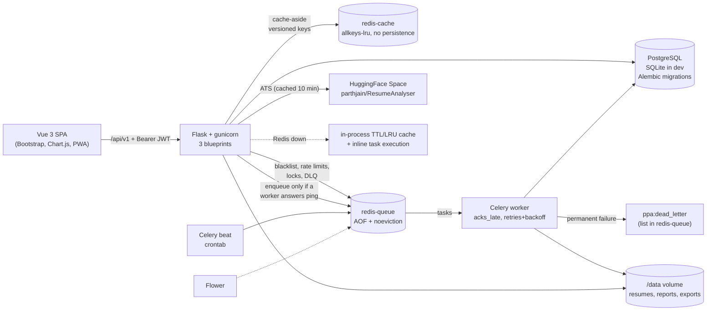

# Placement Portal Application (PPA V5)

> **Campus placement system** — `Flask REST + Vue 3 SPA + Redis (cache / queue / state) + Celery + PostgreSQL/SQLite + HuggingFace ATS`
> **Run it:** `docker compose up --build` → <http://localhost:5001> · **API docs:** `/api/docs` (ReDoc), `/api/swagger` · **Spec:** [api.yaml](api.yaml) (OpenAPI, 57 paths, versioned `/api/v1`, contract-tested against the real routes) · **Health:** `/health`
> **Tests:** `pytest -q` (223 tests, no Redis/Postgres needed) · **CI:** [.github/workflows/test.yml](.github/workflows/test.yml)

---

## Table of contents
1. [For recruiters](#for-recruiters)
2. [Quick start](#quick-start)
3. [Architecture](#architecture)
4. [Redis: three jobs, three roles](#redis-three-jobs-three-roles)
5. [Caching — where, how, and what happens when Redis dies](#caching)
6. [Background jobs (Celery)](#background-jobs-celery)
7. [Security & sessions](#security)
8. [Live notifications (outbox → Streams → SSE)](#live-notifications-transactional-outbox--redis-streams--sse)
9. [File storage](#file-storage)
10. [Observability (metrics, tracing, dashboards)](#observability)
11. [Database & migrations](#database--migrations)
12. [API](#api)
13. [Testing, load testing, chaos](#testing-load-testing-chaos)
14. [Deploying](#deploying)
15. [Configuration](#configuration)
16. [Project structure](#project-structure)
17. [Demo accounts](#demo-accounts)
18. [Limitations & roadmap](#limitations--roadmap)

---

## For recruiters

I'm Parth Jain, a student in the IIT Madras BS program. I built PPA to solve a real campus problem (spreadsheets, email approvals, no eligibility checks, duplicate applications) and to show that I can design, build, test and harden a multi-role system — not just a CRUD tutorial.

**What to look at (in order of effort):**

| 30 seconds | Where |
|---|---|
| Zero-typing login | Click the Admin / TechNova / Kavya pills on the login screen |
| Approval workflow | Admin → Companies → Approve; company posts a drive; admin approves; student applies |
| Eligibility rules | Apply with a CGPA/branch/year that doesn't match → rejected; apply twice → `409` |

| 5 minutes | Where |
|---|---|
| Resilience | `python scripts/chaos_demo.py` kills Redis on purpose; reports still generate (inline), `/health` degrades, recovery is automatic |
| Cache correctness | `tests/test_browse_cache.py` — regression tests for stale-cache bugs I found and fixed |
| Async design | `backend/celery_worker.py`, `tasks.py`, `dead_letter.py`, `async_dispatch.py` |
| Security | `ratelimit.py`, `auth.py` (stateful JWT logout), magic-byte upload check, sanitising, `tests/test_platform.py` |

**Engineering stories (problems I hit and fixed):**
- **Stateless JWT logout hole** → every token carries a `jti`; logout stores it in Redis with a TTL equal to the token's remaining life; the decoder rejects blacklisted tokens.
- **"Pending forever" jobs** → the old code only checked whether Redis was up. Now a task is queued only if a Celery worker actually answers a ping (cached 15 s); otherwise it runs inline.
- **Stale cache** → approving a drive deleted key `approved_drives` but the cache stored `approved_drives_paginated`, so the student list never refreshed. Replaced by namespace-versioned keys (`invalidate("drives")`) with regression tests.
- **Cache that never hit** → the ATS cache key used Python's `hash()`, which is randomised per process. Now SHA-256.
- **Permanent lock-out bug** → the rate limiter did `INCR` then `EXPIRE` as two calls; a crash in between left a counter with no expiry. Now one atomic `MULTI/EXEC`.
- **Spoofable rate limit** → it trusted `X-Forwarded-For` from the client. Now it uses the socket address and only trusts N configured proxy hops.
- **Beat schedule that never fires** → "every 30 days" interval schedules restart whenever beat restarts. Replaced with `crontab`.
- **Secrets in git** → removed from `config.py`; production refuses to boot without real secrets.

---

## Quick start

**Docker (recommended)** — brings up web, worker, beat, PostgreSQL and two Redis instances:
```bash
docker compose up --build                 # http://localhost:5001
docker compose --profile monitoring up    # + Flower (task monitor) on :5555
docker compose run --rm web seed          # reset demo data
```

**Native (Windows/macOS/Linux)** — see [Startup.txt](Startup.txt). The short version:
```powershell
python -m venv .venv; .\.venv\Scripts\Activate; pip install -r requirements-dev.txt
cd backend; python app.py                 # SQLite, migrations + demo data applied on first boot
```
Redis, the worker and beat are all optional locally: without Redis the app uses an in-process cache and runs "async" jobs inline.

---

## Architecture



Every route follows `decorator → get data → validate → query → jsonify`. Roles: **Admin** (approve companies/drives, reports, user moderation), **Company** (drives, applications, interviews), **Student** (browse, apply, interviews, history, ATS check, CSV export).

State machines: `Company pending→approved/rejected` · `Drive pending→approved/rejected→closed` (closed/rejected drives can't be edited) · `Application applied→shortlisted→selected/rejected→withdrawn` · `Interview pending→passed/failed`. `UniqueConstraint(student, drive)` makes duplicate applications impossible even under a race (the second request gets `409`).

---

## Redis: three jobs, three roles

Redis does three different jobs that need **opposite** guarantees, so they're separated ([config.py](backend/config.py), [docker-compose.yml](docker-compose.yml)):

| Role | Env var | Holds | Policy |
|---|---|---|---|
| **cache** | `REDIS_URL` (DB 0) | cached API payloads | `maxmemory` + `allkeys-lru`, no persistence — losing it is free |
| **broker** | `CELERY_BROKER_URL` (DB 1) | Celery queue | AOF `everysec`, `noeviction` — evicting a queued job loses work |
| **state** | `STATE_REDIS_URL` (DB 2) | JWT blacklist, rate-limit counters, idempotency locks, dead-letter list | same instance as the broker: an evicted blacklist entry would silently un-revoke a token |

Client library: **redis-py 6+ with `hiredis`** (C protocol parser), one connection pool per role, socket timeouts, TCP health checks, `Retry(ExponentialBackoff)` for transient errors, and a small **circuit breaker** — after a connection failure a role is skipped for 5 s so requests don't each wait out a connect timeout. (The previous code `PING`ed Redis before *every* command.)

---

## Caching

Implementation: [backend/cache.py](backend/cache.py). Tests: `tests/test_cache.py`, `tests/test_browse_cache.py` (every test runs against both the in-memory fallback and a fake Redis).

**What is cached**

| Data | Key namespace | TTL | Invalidated by |
|---|---|---|---|
| Admin dashboard stats | `stats` | 5 min | any registration, approval, drive/application change, report |
| Student "browse drives" — **every** filter/page combination | `drives` | 5 min | drive approved/closed/edited/deleted, company renamed, seed |
| Company dashboard (per company) | `cdash<company_id>` | 2 min | that company's drives/applications change |
| ATS result (per student+drive+resume hash) | `ats` | 10 min | expiry only; fallbacks are **never** cached |

**How it works**
- **Cache-aside with stampede protection** — `cache_get_or_set(key, loader)`: on a miss one caller takes a short `SET NX` lock and rebuilds; concurrent callers wait briefly for it instead of hammering Postgres.
- **Namespace versioning, one round trip** — entries live at `ppa:<CACHE_KEY_VERSION>:<namespace>:<params>` and store `{"v": <namespace token>, "d": data}`. A read is a single pipelined `GET token` + `GET entry`; the entry is valid only if its token matches. `invalidate("drives")` replaces the token: O(1), no `KEYS`/`SCAN`, instantly effective. Bump `CACHE_KEY_VERSION` to drop everything after changing a payload shape.
- **Race-safe writes** — the token is read *before* the loader runs and stored with the result, so a value computed across an invalidation is never served as fresh.
- **Eviction-safe** — tokens are timestamps and are re-minted with `SET NX` if Redis evicts them (the cache instance is `allkeys-lru`), so eviction can't resurrect stale entries.
- **Outage-safe** — an invalidation that can't reach Redis is remembered and replayed on reconnect (otherwise entries cached before the outage would come back as "fresh"). While degraded, the per-process memory copy is capped at 30 s because other workers can't see this process's invalidations.
- **Safe lock release** — the stampede lock is only deleted by its owner.
- **Every key has a TTL** (hard cap 6 h, ±10 % jitter to avoid synchronized expiry). `scripts/redis_ttl_audit.py` verifies this on a live Redis.
- **Dashboard queries** were rewritten from ~20 `COUNT`s (and 1+N for the company view) to a few `GROUP BY`s.
- `Cache-Control: no-store` on every `/api/*` response, so browsers/proxies never serve stale API data; the service worker doesn't cache the API either.
- Hit rate and backend are visible at `/health` and `GET /api/v1/admin/cache-stats`.

**Fallbacks (nothing crashes)**
1. Redis down → bounded in-process TTL/LRU cache (per process, so only a performance degradation).
2. Rate limiter → atomic Redis counter, else in-memory counters.
3. JWT blacklist → Redis (shared across workers), else in-memory (single process; fail-open is documented below).
4. Tasks → Celery if a worker is alive, else run inline.
5. HuggingFace asleep → `200` with a clearly flagged basic analysis (UI shows a warning banner) instead of a `500`.

---

## Background jobs (Celery)

[backend/celery_worker.py](backend/celery_worker.py) · [tasks.py](backend/tasks.py) · [async_dispatch.py](backend/async_dispatch.py) · [dead_letter.py](backend/dead_letter.py)

- **Dispatch** (`dispatch(task, ...)`): queue it only if the broker is reachable *and* a worker answers a ping; otherwise run inline. Response includes `"mode": "queued" | "sync"`; the UI polls `GET /api/v1/jobs/<id>` either way.
- **Reliability**: `acks_late` + `reject_on_worker_lost` (a crashed worker's task is re-queued), `visibility_timeout=2h` (longer than the longest task, so nothing is run twice by redelivery), `prefetch_multiplier=1`, `task_time_limit=600`, `task_ignore_result` (job state lives in the `AsyncJob` table).
- **Retries**: transient errors (DB/Redis/network/disk) retry with exponential backoff (60 s, 120 s, 240 s…, max 3). Programming errors don't retry.
- **Dead-letter queue**: a task that exhausts retries or fails permanently is pushed to the Redis list `ppa:dead_letter` (capped at 1000). Inspect with `GET /api/v1/admin/dead-letters`, replay with `POST /api/v1/admin/dead-letters/<task_id>/replay`.
- **Idempotency**: reminders are one-per-student-per-drive (checked before inserting), a monthly report upserts its row and e-mails the admin at most once per day (`SET NX` guard), exports use a deterministic filename per job and a completed job is a no-op. So redelivery, retries and double clicks are harmless.
- **Schedules** are `crontab` (daily reminders 08:00 IST, monthly report on the 1st) — not interval schedules, which reset whenever beat restarts.
- **Graceful shutdown**: on `SIGTERM` the worker does a warm shutdown — it stops consuming and finishes the running task. Compose gives the worker a 60 s grace period.
- **Monitoring**: Flower (`docker compose --profile monitoring up`, port 5555).
- **Redis persistence**: the queue instance runs `appendonly yes` / `appendfsync everysec` so a Redis crash loses at most ~1 s of queued messages.

---

## Security

| Control | Where |
|---|---|
| Password hashing (Werkzeug) + constant-ish login timing (dummy hash for unknown users) | `app.py` |
| Access JWT (HS256, **15 min**, `jti`) kept **in JS memory, not localStorage**; **rotating refresh token** in an `httpOnly; SameSite=Strict; Secure` cookie, only its hash stored, **reuse detection** revokes the whole session family; **double-submit CSRF** + Origin check on cookie endpoints | `sessions.py`, `app.py` |
| **Stateful logout**: access-token `jti` blacklisted in Redis with TTL; refresh family revoked; "log out everywhere" | `auth.py`, `app.py` |
| **`Idempotency-Key`** on creating POSTs: retries return the original response, same key + different body → `422`, concurrent duplicate → `409` | `idempotency.py` |
| Role decorators (`@role_required`) on every protected route; ownership checks on company/student resources | `auth.py`, `routes/*` |
| Login rate limit: per IP (20/min) **and** per account (10 failed/min) | `ratelimit.py`, `app.py` |
| Per-user limits on expensive endpoints (report, export, ATS: 10/min) | `@rate_limit` |
| Client IP = socket address; `X-Forwarded-For` only trusted for `TRUSTED_PROXY_COUNT` hops | `app.py` |
| Input sanitising (tags and control characters stripped) on all free-text fields; HTML e-mails escape values | `validators.clean_text` |
| Upload: PDF only, 5 MB, `secure_filename`, **magic-byte check** (`%PDF-`) so a renamed `.exe` is rejected | `routes/student.py` |
| SQL injection: ORM / bound parameters only; a test fails the build if raw SQL string-building appears | `tests/test_platform.py` |
| CORS off by default (same-origin SPA); allow-list via `CORS_ORIGINS` | `config.py` |
| Production refuses to boot without `SECRET_KEY`, `JWT_SECRET_KEY`, `ADMIN_PASSWORD`; no secrets in git | `config.py` |
| Unhandled errors → JSON 500 with a `request_id` (no stack traces to clients) | `app.py` |

Known trade-off: if the state Redis is unreachable at the moment of a request, the blacklist check **fails open** (a revoked-but-unexpired access token would be accepted for up to its remaining ≤15 min life). A warning is logged. For stricter environments make that path fail closed.

### Sessions in detail ([backend/sessions.py](backend/sessions.py))
```
login ──► access JWT (15 min, in memory)  +  Set-Cookie ppa_refresh (httpOnly)  +  ppa_csrf (JS-readable)
 …15 min later, any call gets 401 → SPA calls POST /auth/refresh (cookie + X-CSRF-Token header)
refresh ─► NEW access JWT  +  NEW refresh cookie; old refresh token marked "used"
replay of a used token (outside a 10 s grace for two-tabs races) ─► whole family revoked ─► re-login everywhere
```
Why: a stolen *access* token dies in ≤15 min; the long-lived credential is unreadable by JavaScript (XSS can't exfiltrate it); a stolen *refresh* token is detected the first time both the thief and the victim use it. The frontend refreshes proactively at 80 % of the token lifetime and transparently retries a 401 once (reusing the same `Idempotency-Key`).

---

## Live notifications (transactional outbox → Redis Streams → SSE)

[backend/events.py](backend/events.py)

```
business change ─┬─ INSERT notification ┐ same DB transaction
                 └─ INSERT outbox_event ┘   (no "DB says yes, event lost" window)
                          │  relay: right after commit (~ms)  +  Celery beat every 30 s (safety net)
                          ▼
        Redis Stream  ppa:notif:<user>  (capped, expiring)   +   ppa:events (global audit log)
                          │  XREAD BLOCK
                          ▼
        GET /api/v1/notifications/stream  (Server-Sent Events, id = stream id, resumable via Last-Event-ID)
                          ▼
        SPA: toast + bell badge  (de-duplicates by notification id; falls back to 30 s polling if the stream is down)
```
- **At-least-once** delivery by design (publish, then mark published) → consumers de-duplicate. Exactly-once is not achievable cheaply; idempotent consumers are.
- **Redis down?** events stay in the outbox (nothing lost) and are relayed when it returns; clients poll meanwhile. **Redis not configured?** an in-process stream keeps the feature working in dev.
- **Capacity**: every open stream holds a worker thread, so `SSE_MAX_CONNECTIONS` caps it per process (`503 stream_full` → client polls), gunicorn runs `gthread` with many threads, and streams are recycled every `SSE_MAX_SECONDS`. For thousands of concurrent users move SSE to an async worker class or a dedicated service.

---

## File storage

[backend/storage.py](backend/storage.py) · full explanation in [docs/STORAGE.md](docs/STORAGE.md)

Uploads, reports and exports go through a `Storage` interface (`local` | `s3` — AWS S3 / Cloudflare R2 / MinIO | `azure` Blob). The database stores **keys** (`resumes/resume_3_cv.pdf`), not machine-specific paths, so web replicas and Celery workers on different hosts see the same files. `scripts/migrate_storage.py` moves existing files; legacy path values keep resolving on the local backend.

---

## Observability

- **Structured JSON logs** in production (`LOG_JSON=1`): `{"ts","level","logger","request_id","event":"hf_api_fallback","student_id":123,"reason":"timeout"}` via `log_event()`. Dev logs are human-readable. Level defaults: `DEBUG` in development, `WARNING` in production (`LOG_LEVEL` overrides).
- **Request IDs**: every request gets (or accepts a sane client-supplied) `X-Request-ID`, echoed in the response, attached to every log line and propagated into Celery task headers so one user action can be traced across web → queue → worker.
- **`X-Response-Time`** header; requests slower than 1 s log a `slow_request` event.
- **`/health`**: database, both Redis roles, Celery worker count and mode (`async` / `sync-fallback`), cache hit-rate. `503` only if the database is down.
- **Sentry**: set `SENTRY_DSN` (Flask + Celery integrations, no PII).
- **Flower** for live task execution.
- **Prometheus metrics** at `/metrics` ([backend/metrics.py](backend/metrics.py)): RED metrics labelled by *route template* (bounded cardinality), plus scrape-time gauges for Celery queue depth, workers online, dead letters, outbox backlog, open SSE streams and Redis up/down per role. Bearer `METRICS_TOKEN`; **disabled in production without a token**. Multi-process aware (gunicorn).
- **Grafana dashboard + alert rules** (`observability/`): `docker compose --profile observability up` → Grafana :3000 (provisioned "PPA – Service overview", 16 panels), Prometheus :9090 (alerts: error rate, p95, Redis down, queue backlog, no workers, dead letters, outbox backlog), Jaeger :16686. Celery task metrics come from Flower's `/metrics`.
- **Distributed tracing (OpenTelemetry)** ([backend/tracing.py](backend/tracing.py)): off unless `OTEL_EXPORTER_OTLP_ENDPOINT` is set. One trace per request: Flask route → SQLAlchemy queries → Redis commands → outgoing HTTP → Celery publish → worker task (context propagated through task headers). `trace_id` is added to every JSON log line.
  ```bash
  OTEL_EXPORTER_OTLP_ENDPOINT=http://jaeger:4318 docker compose --profile observability up --build
  ```
- **Measured numbers**: [docs/PERFORMANCE.md](docs/PERFORMANCE.md) (reproducible with `scripts/benchmark.py` and Locust).

---

## Database & migrations

Schema changes are version-controlled with **Alembic** (Flask-Migrate) in [migrations/](migrations/):
`0001` baseline · `0002` query indexes · `0003` composite indexes for the sorted lists · `0004` refresh tokens + outbox events.

```bash
flask --app backend/app.py db upgrade                      # apply (the Docker entrypoint does this)
flask --app backend/app.py db migrate -m "add column x"    # after editing models.py
flask --app backend/app.py db check                        # CI: models and migrations agree
```
- Development: `AUTO_MIGRATE=1` applies pending migrations on boot. A database created by the old `db.create_all()` is automatically **stamped** at the baseline first, so upgrading an existing `ppa.db` just adds the new indexes.
- Production: `AUTO_MIGRATE=0`; run `db upgrade` explicitly.
- `python scripts/explain_queries.py` prints query plans (`EXPLAIN ANALYZE` on PostgreSQL). Every heavy query uses an index; the composite indexes remove the sort step for "approved drives by deadline" and "applications for a drive by date".

14 tables: `users, student_profiles, company_profiles, placement_drives, applications, drive_approvals, interviews, placement_history, monthly_reports, notifications, async_jobs, skills, refresh_tokens, outbox_events`.

---

## API

57 paths in [api.yaml](api.yaml), validated as OpenAPI 3 in CI **and checked against the routes Flask actually serves** (`tests/test_api_spec.py` fails if they drift), rendered at `/api/docs`.

- **Versioned**: `/api/v1/...`. Old unversioned `/api/...` paths still work as a deprecated alias (responses carry `Deprecation: true` and a `Link: rel="successor-version"` header). `/health` and the docs are unversioned.
- **Pagination everywhere**: `?page=&per_page=` (default 6, max 50) → `{items,total,pages,page,per_page,has_next,has_prev}`. `page=999` returns an empty list, not an error.
- **Errors**: `{ "error": "..." }`; rate limits return `429` + `Retry-After`; unexpected errors return `500` with a `request_id`.
- **Async endpoints** (`reports/generate`, `export-applications`) return `202 {job_id, mode}`; poll `GET /jobs/<id>`.
- **Idempotency**: send `Idempotency-Key: <uuid>` on POSTs that create things; retries replay the original response.
- **Live updates**: `GET /notifications/stream` (SSE, resumable with `Last-Event-ID`).
- **Auth flow**: `/auth/login` → access token + cookies, `/auth/refresh`, `/auth/logout`, `/auth/logout-all`.

---

## Testing, load testing, chaos

```bash
pip install -r requirements-dev.txt
pytest -q          # 223 tests: auth/JWT/blacklist, refresh-token rotation + reuse detection + CSRF, Idempotency-Key,
                   #   rate limits, cache (memory + fake Redis), storage (disk + S3/moto + Azure fake), outbox/SSE,
                   #   metrics + tracing, tasks/retries/idempotency/DLQ, eligibility, uploads, OpenAPI contract, SQL audit
flake8             # lint
```
- `locust -f loadtests/locustfile.py --host http://localhost:5001 -u 50 -r 10 -t 60s --headless --html loadtests/report.html` — 50 users (admins hammering *Generate Report*, students browsing). Expect `POST /reports/generate` to stay fast (enqueue only), reads to be cache hits, and the per-user limiter to answer `429`s. **Add your own screenshot of `report.html` here after a run.**
- `python scripts/chaos_demo.py` — scripted story for a demo video: queue works → stop both Redis containers → `/health` degrades → a report still completes inline → Redis returns → async resumes.
- `python scripts/redis_ttl_audit.py` — flags application keys without an expiry.
- `python scripts/benchmark.py --write` — reproducible before/after numbers (statement counts + latency); results in [docs/PERFORMANCE.md](docs/PERFORMANCE.md).

---

## Deploying

- Docker: `docker compose up --build` locally; production overlay with HTTPS: `docker-compose.prod.yml` + `deploy/Caddyfile`.
- **Free hosting options, Azure free-tier facts and a pre-flight checklist: [docs/DEPLOY_FREE.md](docs/DEPLOY_FREE.md).**
- File storage for multi-replica setups: [docs/STORAGE.md](docs/STORAGE.md).

---

## Configuration

All configuration is environment variables; see [.env.example](.env.example) for the full annotated list. The ones that matter most:

| Variable | Default | Purpose |
|---|---|---|
| `APP_ENV` | `development` | `production` requires real secrets, JSON logs, no auto-migrate |
| `DATABASE_URL` | SQLite file | PostgreSQL URL in production |
| `REDIS_URL` / `CELERY_BROKER_URL` / `STATE_REDIS_URL` | DB 0 / 1 / 2 of one local Redis | cache / queue / durable state |
| `TRUSTED_PROXY_COUNT` | `0` | reverse-proxy hops to trust for client IP |
| `CORS_ORIGINS` | *(empty = off)* | cross-origin allow-list |
| `LOGIN_RATE_LIMIT`, `LOGIN_EMAIL_RATE_LIMIT`, `HEAVY_ENDPOINT_RATE_LIMIT` | 20 / 10 / 10 per min | rate limits |
| `SENTRY_DSN`, `LOG_LEVEL`, `LOG_JSON` | — | observability |
| `METRICS_TOKEN`, `OTEL_EXPORTER_OTLP_ENDPOINT` | — | `/metrics` auth (disabled in prod without it); enable tracing |
| `STORAGE_BACKEND`, `S3_*`, `AZURE_STORAGE_*` | `local` | where files live |
| `JWT_ACCESS_TOKEN_EXPIRES`, `REFRESH_TOKEN_DAYS`, `COOKIE_SECURE` | 900 s / 7 d / off (on in prod) | sessions |
| `SSE_MAX_CONNECTIONS`, `SSE_MAX_SECONDS` | 50 / 300 | live-notification capacity |
| `MAIL_*`, `GCHAT_WEBHOOK_URL` | unset | optional notifications (skipped when unset) |

The app has no dependency on any hosting platform: it is a Docker image + PostgreSQL + Redis, so it runs the same on a laptop, a VM, or any container host.

---

## Project structure

```
backend/
  app.py              app factory, auth/notification/health/docs routes, request hooks, error handlers
  config.py           env-driven config (three Redis roles, rate limits, logging, secrets)
  cache.py            Redis pools + circuit breaker, versioned cache-aside, stampede lock, memory fallback
  ratelimit.py        atomic fixed-window limiter (+ @rate_limit decorator)
  auth.py             JWT, jti blacklist, role decorators
  celery_worker.py    Celery config, DLQ hook, request-id propagation
  tasks.py            reminders, monthly report, CSV export (retries + idempotency)
  async_dispatch.py   "queue if a worker is alive, else run inline"
  dead_letter.py      dead-letter list: push / list / replay
  logging_config.py   JSON logs, request-id context
  validators.py       validation, sanitising, PDF signature check
  sessions.py         refresh tokens: rotation, reuse detection, cookies, CSRF
  idempotency.py      Idempotency-Key decorator
  events.py           outbox -> Redis Streams -> SSE
  storage.py          local / S3-compatible / Azure Blob
  metrics.py  tracing.py   Prometheus RED metrics + live gauges; OpenTelemetry
  pagination.py  models.py  SampleDataSeed.py  routes/{admin,company,student}.py
frontend/             Vue 3 SPA (templates/index.html, static/js/app.js), PWA manifest + service worker
migrations/           Alembic revisions 0001-0004
tests/                pytest suite
scripts/              chaos_demo.py, benchmark.py, explain_queries.py, redis_ttl_audit.py, migrate_storage.py, make_dashboard.py
observability/        prometheus.yml, alerts.yml, Grafana provisioning + dashboard
docs/                 PERFORMANCE.md, STORAGE.md, DEPLOY_FREE.md
loadtests/            locustfile.py
docker/entrypoint.sh  web | worker | beat | flower | migrate | seed
Dockerfile  docker-compose.yml  api.yaml  requirements*.txt  setup.cfg  .github/workflows/test.yml
```

---

## Demo accounts

Seeded automatically on first boot (`AUTO_SEED=1`) or with `python seed.py`. **Change or disable these anywhere that is not a demo** (`AUTO_SEED=0`, strong `ADMIN_PASSWORD`).

| Role | Email | Password |
|---|---|---|
| Admin | `jainparth7040@gmail.com` | `admin123` |
| Company | `hr@technova.com` / `careers@greenleaf.com` | `Tech@123` / `Green@123` |
| Students | `rahul.verma@student.com`, `kavya.nair@student.com`, `rohan.joshi@student.com`, `sneha.patel@student.com`, `arjun.mehta@student.com` | `Rahul@123`, `Kavya@123`, `Rohan@123`, `Sneha@123`, `Arjun@123` |

Sample résumés for the ATS check are in `Sample Resumes/`; the expected score matrix is in [sample_test_data.md](sample_test_data.md).

---

## Limitations & roadmap

- Search is a `LIKE` scan limited to 20 rows (fine at campus scale; PostgreSQL full-text search or `pg_trgm` next).
- SSE holds a thread per open stream; for thousands of concurrent users use an async worker class or a dedicated stream service.
- Passwords use Werkzeug's scrypt: deliberately slow (≈0.6 s p50 under 25 concurrent logins on one CPU) — consider a separate auth worker pool at scale.
- "My interviews" lists are paginated in Python after loading; a SQL join would scale better.
- Notifications are polled; WebSockets/SSE would make them live.
- Blacklist check fails open if the state Redis is unreachable (see Security).
- `datetime.utcnow()` is still used in places (deprecated, works); migrating to timezone-aware datetimes needs a data migration.
